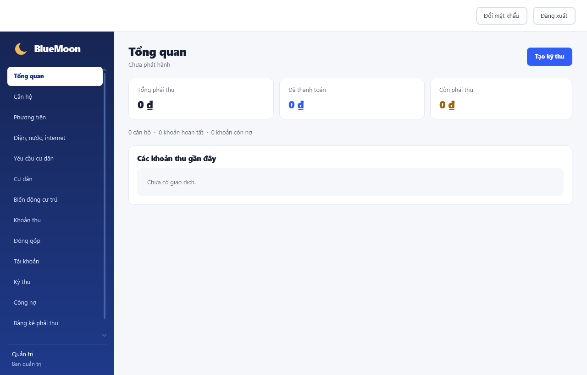

# BlueMoon

Ứng dụng desktop quản lý căn hộ, cư dân và thu phí chung cư cho ban quản trị và kế toán.



## Chức năng

- Quản lý căn hộ, nhân khẩu, phương tiện và biến động cư trú.
- Thiết lập khoản thu, đơn giá và phát hành kỳ thu theo tháng.
- Tra cứu bảng kê, in thông báo, thu tiền, theo dõi công nợ và số dư nộp trước.
- Quản lý hóa đơn điện, nước, internet, đóng góp tự nguyện và yêu cầu cư dân.
- Quản lý tài khoản, phân quyền, đổi mật khẩu và xuất CSV.

## Cài đặt và chạy

Cần **JDK 25**, Git và Docker Desktop đang chạy. Dự án dùng Maven Wrapper, không cần cài Maven riêng. Lần chạy đầu cần mạng để tải các thư viện.

```powershell
git clone https://github.com/minhduong06-td/IT3180_2026.1_Nhom5.git
Set-Location IT3180_2026.1_Nhom5
.\mvnw.cmd -version
docker compose up -d
docker compose ps
```

Kiểm tra Maven đang dùng Java 25 và chờ MySQL chuyển sang `healthy`, rồi mở ứng dụng:

```powershell
.\mvnw.cmd javafx:run
```

Docker Compose chạy MySQL; cửa sổ desktop được chạy bằng Java trên máy.

Khi tạo volume mới, Docker nạp cấu trúc bảng và dữ liệu khởi tạo từ `database/demo-data.sql`. Ứng dụng mở màn hình đăng nhập với các tài khoản dưới đây; hãy đổi mật khẩu sau lần đăng nhập đầu.

| Vai trò | Email | Số điện thoại | Mật khẩu ban đầu |
|---|---|---|---|
| Ban quản trị | `admin@bluemoon.vn` | `0901000001` | `admin123` |
| Kế toán | `ngan@bluemoon.vn` | `0901000002` | `accountant123` |
| Cư dân | `an@bluemoon.vn` | `0901000101` | `resident123` |

Màn hình đăng nhập nhận email hoặc số điện thoại. Tên tài khoản nội bộ `admin` được giữ cho Ban quản trị; tài khoản kế toán và cư dân dùng username gắn với tên người, nhưng người dùng thông thường không cần nhập username. Người dùng có thể chọn **Quên mật khẩu?** ở màn hình đăng nhập để đặt mật khẩu mới bằng email hoặc số điện thoại đã đăng ký; khi đã vào ứng dụng, thao tác **Đổi mật khẩu** yêu cầu mật khẩu hiện tại. Bản desktop không gửi OTP qua email hoặc SMS, nên bước xác minh dựa trên thông tin liên hệ lưu trong hệ thống.

## Khởi tạo lại dữ liệu

Volume Docker chỉ nạp `schema.sql` và `demo-data.sql` ở lần tạo đầu tiên. Sau khi đổi cấu trúc bảng hoặc nội dung seed, cần sao lưu dữ liệu cần giữ rồi tạo lại volume:

```powershell
docker compose down -v
docker compose up -d
```

Lệnh `down -v` xóa toàn bộ dữ liệu trong volume. Với database cần giữ dữ liệu, hãy nâng cấp cấu trúc bằng câu lệnh SQL thay vì dùng lệnh trên. Ứng dụng vẫn chạy được với database rỗng: tạo database MySQL riêng và đặt các biến kết nối bên dưới. Java tự tạo bảng và yêu cầu tạo quản trị đầu tiên nếu chưa có tài khoản.

## Cấu hình kết nối

Ứng dụng đọc cấu hình từ biến môi trường, mặc định trỏ tới MySQL trong Docker tại `localhost:3306`.

```powershell
$env:BLUEMOON_DB_URL = 'jdbc:mysql://localhost:3306/bluemoon?connectionTimeZone=Asia/Ho_Chi_Minh'
$env:BLUEMOON_DB_USER = 'bluemoon'
$env:BLUEMOON_DB_PASSWORD = 'mat-khau-cua-ban'
```

Để dùng MySQL riêng, tạo database và cấp quyền cho user trước, sau đó đặt các biến trên trong cùng cửa sổ PowerShell chạy ứng dụng. Thay biến kết nối không đổi mật khẩu của MySQL trong Docker.

## Kiểm tra và tài liệu

Chạy các test không cần MySQL:

```powershell
.\mvnw.cmd "-Dtest=AuthorizationTest,BillingRulesTest,ResidenceChangeServiceTest,CsvExporterTest,FeeNoticePrinterTest,DemoDataSqlTest" test
```

Test tích hợp cần database riêng, rỗng và có thể xóa. Xem [hướng dẫn QA](docs/QA.md) trước khi chạy; thiếu `BLUEMOON_IT_DB_URL` sẽ làm test tích hợp bị bỏ qua.

- [PM: quyết định merge và điều kiện nghiệm thu](docs/PM.md)
- [QA: cách kiểm tra và căn cứ đạt](docs/QA.md)
- [Dev: cấu trúc, nghiệp vụ và cách sửa](docs/DEV.md)
- [Quy tắc nghiệp vụ chi tiết](docs/NGHIEP_VU.md)
- [Kế hoạch kiểm thử](docs/QA_TEST_PLAN.md)
- [Kịch bản kiểm thử](docs/QA_TEST_SCENARIO.md)
- [Test case chức năng](docs/QA_TEST_CASE_FUNCTIONAL.md)
- [Test case giao diện](docs/QA_TEST_CASE_UI.md)
- [Test case tích hợp](docs/QA_TEST_CASE_INTEGRATION.md)
- [Dữ liệu kiểm thử](docs/QA_TEST_DATA.md)
- [Biên bản kiểm thử](docs/QA_TEST_REPORT.md)

Các điểm còn mở gồm chống ghi trùng thanh toán, ngày chọn đơn giá, thông tin hộ trên chứng từ cũ, đồng bộ tên chủ hộ và độ trễ khi truy cập MySQL. Chi tiết tại [đối chiếu yêu cầu](docs/SPRINT1_COVERAGE_REVIEW.md).
